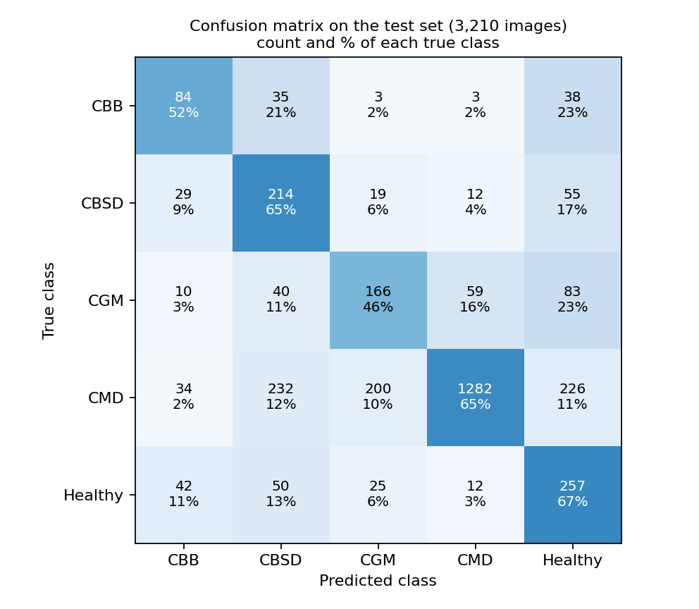
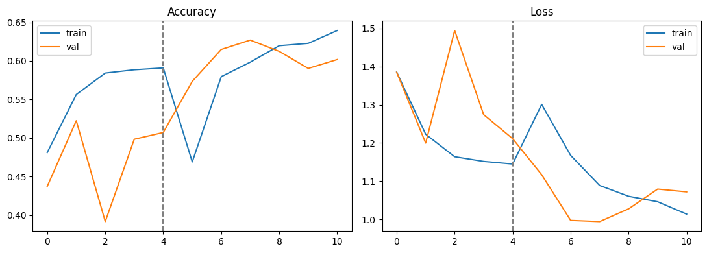

# Cassava Leaf Disease Classification

Final project, AI Study Jams (Kaggle dataset option). A deep learning model that classifies a photo of a
cassava leaf into five classes: four diseases (CBB, CBSD, CGM, CMD) or healthy. Status: baseline done,
improvements in progress.

- Kaggle notebook (public): https://www.kaggle.com/code/yaofranckaimebi/notebookffc0694268
- Prototype (Gradio app): [Hugging Face Space link, to add]
- Report: see the `report/` folder

Author: EBI YAO FRANCK, P. P. Savani University

## Results (baseline)

MobileNetV2 (ImageNet weights), two-phase transfer learning, evaluated once on a held-out test set of 3,210 images.

| Class | Precision | Recall | F1 | Test images |
| --- | --- | --- | --- | --- |
| CBB | 0.422 | 0.515 | 0.464 | 163 |
| CBSD | 0.375 | 0.650 | 0.476 | 329 |
| CGM | 0.402 | 0.464 | 0.431 | 358 |
| CMD | 0.937 | 0.649 | 0.767 | 1,974 |
| Healthy | 0.390 | 0.666 | 0.492 | 386 |

Overall: **62.4% accuracy**, **macro F1 0.526**.

Accuracy alone is misleading: CMD is 61.5% of the images, so always answering "CMD" gives 61.5% accuracy but a
macro F1 of only about 0.15.




## Dataset

[Cassava Leaf Disease Classification](https://www.kaggle.com/c/cassava-leaf-disease-classification) (Kaggle,
Makerere AI Lab): 21,397 labelled field photos, 5 classes, strongly imbalanced. The data is not included in this
repository (about 6 GB, and covered by the competition rules). The competition test set is hidden, so
`train.csv` is split 70% / 15% / 15% (stratified, seed 42).

## Reproduce the training

1. On Kaggle, join the competition above and accept its rules.
2. Create a notebook, then File > Import Notebook and load `notebooks/01_baseline_mobilenetv2.ipynb`.
3. Add the competition data with Add Input, and enable the GPU and Internet in the session settings.
4. Run all cells. The last cell saves `cassava_mobilenetv2.keras`.

The first configuration cell has `SAMPLE = 4000` for a quick test run; set `SAMPLE = None` for the full dataset.

## Run the prototype

```bash
cd prototype
pip install -r requirements.txt
# download cassava_mobilenetv2.keras (Hugging Face Space files, or the Kaggle notebook output)
# and place it next to app.py
python app.py
```

Use the same TensorFlow version as the training notebook, otherwise the model may not load.

## Experiments log

One change at a time, chosen on the validation set. The test set is looked at only for the model kept.

| Run | Change | Validation macro F1 | Test accuracy | Test macro F1 | Notes |
| --- | --- | --- | --- | --- | --- |
| 0 | Preliminary run, 4,000-image subset | not measured | 0.657 | 0.520 | Different test set (600 images), not comparable |
| 1 | Baseline, full dataset | not measured | 0.624 | 0.526 | Early stopping at epoch 5 and 6 |

## Roadmap

- [ ] More tolerant training (patience 5, learning rate schedule, up to 25 epochs)
- [ ] Unfreeze more layers during fine-tuning
- [ ] Larger input size (320 or 384 pixels)
- [ ] Softer class weights
- [ ] Second architecture (EfficientNetB0) for comparison
- [ ] Grad-CAM explanations and a lightweight phone version

## Credits and sources

- Dataset: Cassava Leaf Disease Classification, Kaggle competition, Makerere AI Lab.
- Model: M. Sandler et al., "MobileNetV2: Inverted Residuals and Linear Bottlenecks", CVPR 2018.
- Libraries: TensorFlow/Keras, scikit-learn, pandas, matplotlib, Gradio.
- The structure of the notebook was first drafted with the help of an AI assistant (Claude, Anthropic);
  the author ran, adapted and analysed it.

This is a prototype for a student project: always confirm a diagnosis with an agricultural expert.
